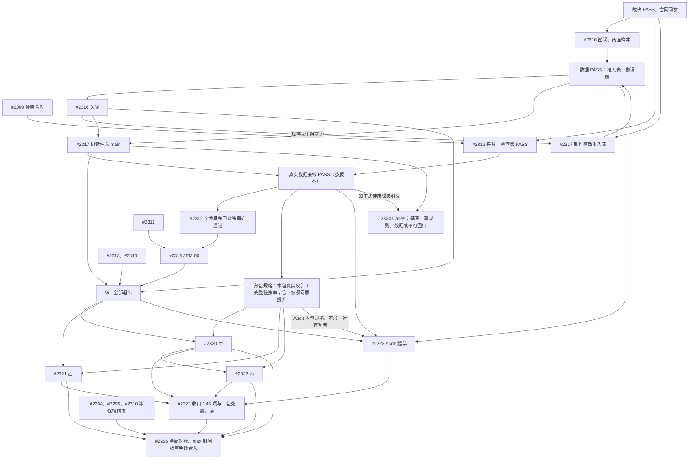

VERDICT: BLOCK

**绑定**：[地图 #2293](https://github.com/Newchanlun/NewChanlun/issues/2293)；受审对象是 [#2316 评论 7162413718，裁决草案第二稿](https://github.com/Newchanlun/NewChanlun/issues/2316#issuecomment-7162413718)，`updated_at=2026-11-25T12:28:08Z`。从同一份 GitHub API 响应取时间和 `body`；将解码后的字符串直接编码为 UTF-8，不计 CLI 显示时追加的换行。**11,903 字节，SHA-256：`d6afed813c6449539db3e10ca18dbcbd596248b24e85101c7233e4ebd8927e18`**。下文 D 为这段正文的物理行。起草：Claude Fable 5.2；独审：GPT-6.2 Astra，`max`，独立只读进程。

**决定性反例是票边，不是抽样误差。** 第二稿要求 #2317 生产有效准入表、#2316 等该表和勘误表的实物独审通过后关闭，但 #2317 的开工条件仍是 #2316 通过，tracker 也仍以 #2316 为阻塞票。照稿同步，哪怕检查器明天就合格，数据也没有获准的生产起点。一级区间准入、二级缺证拒收、备包防少列这三处改动应保留。退回裁决设计；原件甲、乙双 BLOCK 不变，不解冻下游。

**证据索引。** 回读了[第一稿](https://github.com/Newchanlun/NewChanlun/issues/2316#issuecomment-7161977825)、[第一稿独审 R1–R8 及七项清单](https://github.com/Newchanlun/NewChanlun/blob/9a3a0a6a1ad95266e86113ea761d4eef18eb6aa5/audit-reports/2316/FM-09a-decision-review.md)、[一审](https://github.com/Newchanlun/NewChanlun/blob/187e116e999871b92b4703d3a6e4129bc5edafa7/audit-reports/2316/FM-09a-audit.md)、[二审](https://github.com/Newchanlun/NewChanlun/blob/187e116e999871b92b4703d3a6e4129bc5edafa7/audit-reports/2316/FM-09a-audit-r2.md)、[三审](https://github.com/Newchanlun/NewChanlun/blob/0ca418404ed6da0c0f3c7c3d2313997fac37aba8/audit-reports/2316/FM-09a-audit-r3.md)。除非另标版本，H、M、台账、lib 分别指提交 `77c6aa6eb86ced320ea7d2e15a20087c4fa63922` 的[手册](https://github.com/Newchanlun/NewChanlun/blob/77c6aa6eb86ced320ea7d2e15a20087c4fa63922/fm09-register/FM-MASTER-PLAN-v2.md)、[主册](https://github.com/Newchanlun/NewChanlun/blob/77c6aa6eb86ced320ea7d2e15a20087c4fa63922/fm09-register/FM-09-%E5%8E%9F%E5%85%B8%E7%99%BB%E8%AE%B0%E5%86%8C.md)、[ledger_final.jsonl](https://github.com/Newchanlun/NewChanlun/blob/77c6aa6eb86ced320ea7d2e15a20087c4fa63922/fm09-register/tmp/ledger_final.jsonl)、[lib.py](https://github.com/Newchanlun/NewChanlun/blob/77c6aa6eb86ced320ea7d2e15a20087c4fa63922/fm09-register/tmp/lib.py)。课:行均为[同提交的博文正本](https://github.com/Newchanlun/NewChanlun/tree/77c6aa6eb86ced320ea7d2e15a20087c4fa63922/docs/chanlun/text/blog)物理行，id 取 JSON 字段，不是文件行号。

## 甲｜七条修订逐条判定

| 第一稿独审所要求的修订 | 判定 | 第二稿改到了哪里，还有什么差额 |
|---|---|---|
| 1. 事实依据 | **部分满足** | §〇.1–4（D7–10）订正了四组发现、卡片分母、停止第四轮的理由和文档名分。D7 仍说“点名的位置每轮闭合”；B-23 的同一句三版未变，K3 的同一问题段到三修才闭合，见丙。 |
| 2. 一级实物 | **已满足** | §二（D22–32）把历史 790 条与可用作者区间分开；1259 整句拒、265 注前片段可收，018:26 缺录走有版本的增补与复核，指纹不符整表失效。乙1 给出原行和新抽样。 |
| 3. 二级提升 | **已满足（归属规则）** | §三（D36–47）有身份锚、话轮、嵌套角色、段界、禁用优先；沿用语料版本和字符区间；独立封存，再逐字段对原件。v1 不懂二级就拒。A1–A5 给了正反期望。015:1124 缺锚只能交拒收记录，不能把“重标”解释成“六条都须绿”。上线依赖另见乙4。 |
| 4. 全局语义责任 | **已满足（首次验收）** | §一、四（D16–18、55–60）给三轮发现逐项建账，包含甲与无组号项；#2323 审状态理由与跨包互斥，#2296 对账 14/46 与四包。同义反复、条件预案不经 Lean 定义也有人审。后续改判的传播属第 7 项。 |
| 5. 备包与盲写 | **已满足** | §五（D64–66）先定节点、主张、清单和版本，实门校引，再由非作者对照必要证据查漏。只给盲写者密封输入，改引文或主张要重新验审、保留原稿；改锁另验。空包或少列不能凭“已列者皆绿”启动。 |
| 6. 生效合同 | **部分满足** | §六（D70–88）区分六种 PASS，保留实际数据独审，重写整册零红、Audit 启动边和 #2296 对账；但 #2316/#2317 的先决相咬，#2312 的门 11 消费范围还丢了现合同中的正式记录。 |
| 7. 判例消费与撤销 | **部分满足** | §三（D49–51）把 #2324、Cases、FM-72 纳入，区分预案、结果与不可回归；出处撤销或区间缩小会反查。但三者只明订同版**准入表与提升记录**，未绑定同版**勘误**；仅改变定性而不改归属或区间时，既有消费件没有相应的失效条件。 |

## 乙｜五问的实物检验

### 1. id 1259 能拦住；词筛只能分派复核，不能签发准入

按台账原序取 `who == "正文"`，1,604 条中有 **790 条、790 个不同 id、706 个课行**。给“提到、含括号”一个可复算口径：`note` 匹配字面 `编者注|括注|行内注`；`quote` 含任一中英文圆括号字符 `[()（）]`（允许像 1259 那样半角开、全角闭）。两项分别命中 **54、48** 条，交集 **10**，并集 **92**，其余 **698**。若把摘句的 `[]【】〔〕` 也算括号，并集是 **99**；若备注凡含“编者”均捞、摘句仍只算圆括号，是 **102**；两种都扩则 **109**。这些都是待人工判的条数，不是污染数。数学区间的方括号也会命中。

| 冻结原件 | 实测与裁断 |
|---|---|
| id 1259，081:42，界在 :78，M804 仍以整句作正文 | 摘句 `[78,127)`，编者括注 `[114,126)`；备注明指编者注。冻结 lib 返回 `region=B, note_spans=[], find_quote=True`。以不含注的 `[78,114)` 为候选作者区间做包含测试，整句为假；不能去掉中间的注再冒称原文连续整句。 |
| id 265，020:56 | 摘句 `[0,90)`，注 `[90,124)`，包含测试为真。应放行注前原话，不该禁整行。 |
| 018:26 | 原文是对**完成**走势的盘整定义，在 :68 正文界前；全台账按 `cite` 精确查询为零。D31 给出有新版本、经同样核对的增补路径；不应借 018:24 的 id。 |

**另抽 44 条、不与前审的 32 个课行重叠。** 从上述 698 条去掉前审 32 个 id 所在的全部课行，余 665 条。按文件原序用 Python `random.Random(231602).sample(pool, len(pool))` 排列，遇已取课行跳过，取前 44 个不同课行。逐项定位原行、摘句起止并看相邻上下文。下列为抽序，格式为 `id/课:行`：

| 抽次 | 逐条核过的记录 |
|---|---|
| 1–8 | 133/017:22，203/019:18，1501/105:16，140/017:50，530/030:30，374/024:40，857/053:20，733/045:24 |
| 9–16 | 727/044:48，1425/099:30，32/013:28，378/024:48，593/033:34，198/018:56，1041/065:50，201/018:66 |
| 17–24 | 1227/079:36，952/060:32，454/027:44，756/047:24，1035/065:32，639/036:30，920/057:32，283/021:34 |
| 25–32 | 70/015:40，1136/071:32，37/014:14，864/053:32，200/018:64，860/053:26，1256/081:26，1281/082:62 |
| 33–40 | 176/017:58，447/027:20，101/016:34，456/027:48，1297/084:50，46/014:44，1424/099:26，1313/085:42 |
| 41–44 | 761/047:34，1233/079:98，1063/067:28，626/035:24 |

**44 条随机样本未发现筛外摘句夹入编者或读者的话。** 例如 639 的 `[313,421)` 紧贴行内注但不包含它；1063 的 `[0,114)` 截在“娇注”前；727 的前一段是编辑注，044:48 是作者自己设问作答；920 的方括号是价位区间。定向查筛外摘句完全落在原行括注内、以及原行有网友标志的情形，也未取得类似 1259 的编者混入例。081:20 确有网友问答，但不在这 790 个 id 里。

**若问“筛外有没有别人的原话”，有。** 另在随机样本外找到 id **132／017:14**：备注未提编者注、括注或行内注，摘句没有圆括号。原行 `[37,86)` 先是作者自述，随后明写“正如《论语》所说”，`[78,86)` 的“由诲女，知之乎！”是书中人物的话。这里是**作者主动转引**，不是编辑事后插话。可据此说“缠师引用《论语》”，不可把内层八个字单列为缠师原创的定义；台账要支撑的“由实践总结”在作者前段已说完。这个筛外混合声部解释了为什么第 2 步必须覆盖所有 790 条，不能让其余 698 条自动进表。原稿已有全体区间复核、同版实物审和命题忠实审，按这些条件可挡，不必另造词筛；建议把 132 连同 1259 给标注者对照。随机 44 条不能证明其余 654 条全净，第一遍也并非 790 份双人独立阳性标注。本次没有给任何实际准入表签发 PASS。

### 2. 同行说话者可以区分；015:1124 的外层答者身份锚填不出来

以下两条用同一语料指纹 `b6a35574ed6db3625da6d18f4e11c8976874ba66b0e888362e1769483f0c0a0d`，0 起 Unicode 码点、左闭右开；摘要实取该行该片段的 UTF-8 字节。禁用查冻结版 `hard_cite_exclusions.json` 的 `excluded_entries.id`（36）与 `excluded_lines_r3.cite`（11）。这是试填，不代替两家封存。

| 字段 | id 94｜[015:1106–1126](https://github.com/Newchanlun/NewChanlun/blob/77c6aa6eb86ced320ea7d2e15a20087c4fa63922/docs/chanlun/text/blog/015-%E7%AC%AC15%E8%AF%BE.md#L1106-L1126) | id 578｜[032:210–215](https://github.com/Newchanlun/NewChanlun/blob/77c6aa6eb86ced320ea7d2e15a20087c4fa63922/docs/chanlun/text/blog/032-%E7%AC%AC32%E8%AF%BE.md#L210-L215) |
|---|---|---|
| 级别、准入键 | 二级候选；(指纹, 94, 015:1124, `[0,44)`)，止于“怎么看。” | 二级候选；(指纹, 578, 032:212, `[346,373)`)，即末段“确实，写成…”全答 |
| 区间 SHA-256 | `05ee1b90d25517a1979a473a009b5837c05bed8712523d5e9a29ba14767be098` | `1f66439e89b9d4e48b4ac7d0af7477e21b58cc17fca0aaa4e83b0cd0fce2a82d` |
| 外帖、问者与本次答者锚 | 外帖 :1106–1126；中间体 13:55:06。**本次署名/独立同文：缺**。:1108 的“缠中说禅 12:21:37”是被引旧帖头，:1126 只有 15:07:41 尾戳，无署名。 | 外帖 :210–214；本次作者署名 :210，时间在 :212 `[0,19)` 16:28:38；问者未具名。:214 加粗复排末答，是本帖内的段界佐证，不冒充第二个独立署名。 |
| 话轮与嵌套角色 | :1108–1110 是转引作者的作业（旧帖可对 :998–1006）；:1112 后是读者作答、:1118 请求打分。外层第 1 答为 :1122–1124，不隶属旧帖。 | 按印刷顺序为第 2 答，是本次追问的答语。同行首问 `[19,78)`、前答 `[103,175)` 是追问所承接的旧问答；“谢谢你的回答”起的追问 `[201,344)` 属读者。没有用外层署名把整行都认作作者。 |
| 相邻段界、键冲突、处置 | :1120 等号分问答，:1126 尾戳收束，:1128 横线后 :1130 换问者。id、整行禁键均未命中。全文逐行检索摘句及首尾辨识短语（另作去标点、空白的归一检索）只见此处。**答段可定位，身份锚仍空，留在有效表外。** | `[78,103)` 等号、`[175,201)` 横线、`[344,346)` 双等号；行末、:214 复排与 :215 换头收束。id、整行禁键均未命中。**双标及实物审相符后，支持二级的版本可收末答**；同一帖头下的“缠姐，我又有问题了。”在 `[19,29)`，不落准入区间。 |

没有发现两种说话者能以**真实字段**填成同一条记录。只交“同一行、同一帖头”，第二例会撞；加目标区间、话轮与段界就不撞。第一例的缺值是有用的拒收结果，不是缺一个可由主控通融的字段。A4 的验收应允许“改正错头，并标为不准入”；实物没有要求把 94 必做成正例。对 A5，错误的 067:142 不能替代与 067:188–198、070:298–310 对得上的身份锚；id 1271 即使把记录内的禁位改成假，独立禁表仍命中。v1 的全拒不能拿来验这两种错误能否被支持二级的检查器识别。

### 3. 首次定性都有接收票；只改勘误时，旧判例还能带着原 PASS 走

| 放入审查的实际材料 | 不改任何 Lean 定义，应该怎样处置 | 第二稿的接收点 |
|---|---|---|
| 三审 B4（H129、174、387、544、932；M607） | 枚举布尔 D、R 四组值，满足 D∧R 同时使 R 为假的对象是 0 个。能证投影，不可能按 Math/ 合同交它的反例；保留“仅登记/防混用”，不能标“已否证”。 | §四.2、4：#2323 核状态理由与 Math/ 义务，#2296 对四包一并复核；FM-72 最终对账。 |
| 三审 B6（M751；id 1542，106:168） | 原话 `[105,140)` 只给“若构成卖点则……”，`[140,164)` 是编者叙述结果。即使作者片段获准也不证明前件发生、后件兑现。未取得独立行情时只登记预案。 | #2323、#2296 有具名回归；#2324/Cases 依 §一、三在判例被消费处审结果证据。 |
| 一审 N4/B-38、二审 N4（093:26、:28；H112；M659） | :26 说有两种，只列一；:28 明标“娇补注”。登记缺项，不把编辑补出的第二项写成作者已列全。无需改中枢定义。 | #2316 勘误记命题与版本，#2323 审登记理由，#2296 检查 M1 与 B-38 不冲突。 |
| 一审 B-33、二审 B31–35、三审 B9（049:58、72、74；M17、631、633；H107、165） | 作者给出了利润率口径；缺策略比较域与最大性证明。可以排除或列猜想，不得从“没证明”跳到“已发现反例”。 | #2323 制止错挂反例；#2296 对账时不能从 M17 的总览恢复被撤销的说法。 |
| 一审 K7、二审 K7、三审已改对的 105:518（id 1524） | 需区分“作者条件预案”“实测市场结果”“理论反例”。其冻结备注仍把它说成反例，M499、501 已收窄为条件预案，不以编者注独证回拉保证失败。 | #2316 记闭合范围；#2323、#2324 各审自己的状态或判例条目。此例还可检验跨版本更正。 |

**实际缺口是旧消费件的重验，不是以上发现无人首审。** 第一版主册（`4b75e60e9e`，B-17）把 105:518 送进 Audit/FM-60 作反例；三修 M501 把它改成判例记录。两提交间台账和博文目录的 Git 差异为空：**同一 id 1524、同一 `[0,129)`、同一说话者，判例结论已变。** 将此差分代入 D51：既无归属撤销，又无区间缩小，撤销条件为假。D49 让 Cases、FM-72 取同版出处，却未要求它们取同版勘误；D66 针对包自己改主张或引文，不会找出未改字的消费件。于是旧状态若已发出，数据变更当次没有工位必须追回。这是用实物差分检验规则，未声称任何下游已获真实 PASS。应把勘误编号/版本与出处一起绑定到消费件；若命题、状态、理由或结果证据被纠正，按受影响主张定向通知、使旧 PASS 对该处失效并重验。

### 4. 空集、少列的捷径已关；带上原生依赖后，执行图有环

对 H476–477 的 M7 走三次备包判定：(a) 两个答疑都不列，逐引检查可空过，D64 的独审须按节点拒绝缺证；(b) 只列 069:423，虽有真实作者答语，却没有 066:186 的“3+3+3”区间回答，仍拒，D84 更把两处点了名；(c) 两处均列但只持 v1，D36 要求拒二级，不能以双人签字代替实门。相反，确实不需要二级的节点，备齐它所需的一级证据和已裁选择即可，例如只检 H462–464 的正文证据时，不为凑数添答疑。**这是实门验“列得对”加非作者对外部节点清单验“列得全”，不是机器遍历一个空数组就能证明完整。** 包一旦变更，原包规格 PASS 不能覆盖新内容。

下图箭头为“先有 → 才可”，汇合处是**且**。以 D81–88 的具体改写覆盖旧条款，其余保留。原生边另用 GitHub REST `issues/{号}/dependencies/blocked_by` 读取，不从票文的“依赖”两个字猜边。

检查方法：把合取前件列成前驱集合，用拓扑排序取可启动结点。为使测试对草案有利，假定外部先决最终全满足，甚至先给它可用的二级检查器，**也不要求已 BLOCK 的旧件另出 PASS**。仍报三结点环：`数据 PASS → #2316 关闭 → #2317 制表 → 数据 PASS`。裁决、勘误/样本、夹具版检查器有起点；制表、实物审、真实接线及其后的包没有满足全部前件的起点。D72 对“按新规则生产”的总授权不能自行替一张仍有原生阻塞边的票开工；D24 把制表交给 FM-09b，D81 给可先做的 #2316 列的交付只有勘误和样本。把准备与入库分开是可行的**修正**，不是稿中已有的两条票边。图中 P 对各包分别适用，不是等所有规格同时通过；#2323 不需要三包先完成才能起草，只在收口时对读三包。外部先决的明细见乙5。

**最短拆法**：#2316 的证据阶段允许既定制表者在 evidence 候选上制作准入表，非作者另审；#2317 仍只在**新工件的数据 PASS** 后把它入 main。把 #2317 目标里的“FM-09a PASS”明确改成这个里程碑，保留历史双 BLOCK。将“候选制表”移到关 #2316 之前、仍让“入库”等待数据审和关票，重做同一排序：勘误/夹具与制表 → 数据 PASS → 关 #2316 → #2317 入库 → 同版真实接线可以顺排。在其余工件实际交付的假设下，下游也可排。此处验证的是依赖，不是宣布任一工件已完成。

二级是另一个**版本前置**：同时钉住 #2312 检查器版本、真实数据版本、可消费级别。#2312 可在同一票分期交付；D47 已有 A3 提升后必绿的验收目的。不要把 v1 接线 PASS 记成能消费二级的 PASS。M7 的两处、M13 的 081:294 都在正文界外，v1 永远不是这两个包的足够条件；这一点不必解释成第二个必然环。

### 5. 逐票结果：#2317 的开工、#2312 的覆盖面不能照表生效

下列为本次 `gh issue view` 的现票面及原生前置快照。#2316 和 #2312 均仍 OPEN、带 `agent:blocked`；这里只比较拟生效合同，未改任何票。

| 票 | 现约束 → 第二稿拟交付；裁断 |
|---|---|
| [#2316](https://github.com/Newchanlun/NewChanlun/issues/2316) | 无原生前置。原按 H3.7 对两册给判决；D81 保留两个 BLOCK，改交勘误与两面样本，须数据 PASS 才关。此区分正确，不能同时把它的关闭设为制表前件。数据 PASS 验勘误有范围和接收票；允许登记“未闭合”，不必等所有 W2 实施才出数据。 |
| [#2317](https://github.com/Newchanlun/NewChanlun/issues/2317) | 唯一前置 #2316；**目标**首句也是“FM-09a PASS 之后”。D82 只明废**验收**里的“对主册复跑 0 失败”。后者确应废（M804 含注，主册又有界后硬引与裸引）；保留原机读台账/名单/非作者区间/可移植脚本、摘要与指纹，新增有效表的实物正负审。前者及票边未解，见乙4。P4 指定供 Astra 抽审，不能用裁决审、主控自验或仅同家族两人代替。 |
| [#2312](https://github.com/Newchanlun/NewChanlun/issues/2312) | 原生前置 #2309。D83 的夹具/真实数据二段有效，不等同于全票验收。[原数据合同门 11](https://github.com/Newchanlun/NewChanlun/issues/2312#issuecomment-7140143526)枚举“仓内全部带引文的文件”；[v3 定稿](https://github.com/Newchanlun/NewChanlun/issues/2312#issuecomment-7161329832)保留第 0 节七条合同，逐门改动没有裁掉这条。D83 只列“可信目录、包规格、formalization.yaml 的出处字段”，漏掉例如包根 `HISTORY.md` 中的硬引。H307–310、391、947 明定它是修订依据的正式消费件。把 M804 的含注引文只写进该文件、其余三类的引文保持干净：按旧枚举必受检，按新三类可完全不受检；门 16 检查有对应行，不能替门 11 逐字验归属。须保留全部正式引文消费件，明确新增 pack/元数据；历史输入、诊断、故意红的夹具与正式硬引按角色区别。门 11 仍从仓内原件重算，不信调用方给的 JSON 判决；本票其余门、v3 自测、独审与 CI 不减。 |
| [#2320](https://github.com/Newchanlun/NewChanlun/issues/2320) | 原生前置 **#2312、#2316、#2318、#2319**。D84 加包规格，列 M7 两条提升、M9 增补；M6 仍等 #2318 的实物结论。保留等价/分离/未定、分离处置、固定模板、封存再揭示。D84 少写 #2316，但 D88 明保留其余原生边；不能据省写删边，也不能把整个 M7 当成不需出处的项目选择。 |
| [#2321](https://github.com/Newchanlun/NewChanlun/issues/2321) | 前置同甲。081:290–294 是作者独立补充，不得借禁引 081:222；正式消费须先按二级提升。M10 起始包含时方向未定、M11 局部分型与保留作笔端点分型的区别及原对撞合同不变。 |
| [#2322](https://github.com/Newchanlun/NewChanlun/issues/2322) | 前置同甲，**另等 #2320**。D84 对 051:246 的语义收窄对，模块标号不对：H541–542 实际消费点是 M17，M16c 提供力度接口，两者都在丙包。原有力度四参数、假设五项无默认、M19b 签名、DIF 的历史/播种限定仍验；票评明禁把 M16b 候选定义式发给盲写者，不能借“必要反证”泄题。 |
| [#2323](https://github.com/Newchanlun/NewChanlun/issues/2323) | 原来只被 #2316 直接阻塞。D85 是换成“真实数据 PASS **且**接线 PASS”，不是取消等待；W1 整波退出仍在。原有 46 条记录、逐字 Literal、被否定的确切命题及非作者忠实性独审保留；再审状态理由与三包处置。可先起草，收口时要有可对读的三包处置版本；它原为 Fable 起草、Astra 审，不是另造一对盲写者。 |
| [#2324](https://github.com/Newchanlun/NewChanlun/issues/2324) | 原来只被 #2317 直接阻塞，D86 保留。105:518（1524）、108:178（1575）需二级证据才可作作者硬引，081:30（1257）是一级候选。不得因未提升删案例；可写证据不足，保留数据来源、摘要、数字化脚本或不可回归状态、基底和笔规则。制表/数字化作者不能替自己做异家族复核。只写“同版取证”不够解决乙3 的语义更正。 |
| [#2296](https://github.com/Newchanlun/NewChanlun/issues/2296) | 原生前置 #2294、#2295、#2309、#2310、#2312、#2311、#2316、#2320–2323。D87 是增加同版 14/46/四包对账，没有移走这些边。蓝图、Defs、Challenge、全部机械门、R1–R8、`max` 独审与锁合入仍是封口；[来自 #2318 的四个 M6/M7 待裁点](https://github.com/Newchanlun/NewChanlun/issues/2296#issuecomment-7162053019)没有被出处审代答。 |
| [#2293](https://github.com/Newchanlun/NewChanlun/issues/2293) 与手册 | H844–845：W2 入口是 **W1 整波退出**，含 #2309、#2311、#2312、#2315（FM-06）、#2316、#2317、#2318、#2319。#2318 已关不等于整波已退。D88 明保留其他退出条件；H1066 旧硬停止的替代须同 H867 制表先决、H877–881 票表、地图与各票钉的版本一起生效，不能先删硬停止再等新证据。手册 v3 是待产物，不是现行指令。 |

## 丙｜四条事实更正、地图红线与新缺口

1. **§〇.1 前半对，末句错。** B-3、B-23、B-33、B-45 不是三审第一次发现：二审 126、130、132、134（另见一审 136、146、158）已限定面积等号、有限输入后继、利润率与事前预测。三审确有 B-3 的“不大于”、B-33 在 M17 的残留和 B-45 的 106:168 等新落点。可是，即使把“点名的位置每轮闭合”只理解为前述四组，也有直接反例：**B-23「问题」段**的“可证的只有：T1 完成后必有同级别的 T2。”在初版 M546、二修 M547、三修 M547 **逐字不变**；一审第 136 行原已点名 B-23 的有限输入无后继，二审第 130 行再提，三审 B8（第 113 行）还得挡同一句。另一种情况是**后来确实闭合，但不是每轮闭合**：一审第 58 行点名 K3；初版 M465 的 B-14「问题」段判 054:60 为假，二修 `36fc364aea` M466 仍在同一问题段说这条强断言不成立，M468 仍派反例。086:76 反而明确有“下来的那个第二类买点”。二审第 45 行判未闭合，三审第 121 行才闭合。两例都不是另一个未点过的副本。应写成“部分点名项局部闭合；有原处未闭合，也有别处复现”。
2. **§〇.2 对。** 从 H439–563 提取 `【(?:原文|正文|答疑|课间|解盘) (三位课号:行)】`，按原课正文界（含 lib 的人工末行）分内外，界外再连台账 `who`。按框计得总 69／外 17／其中答疑 8（另课间 4、解盘 5）；同一 H 行去重 64／15／8；全节去重 62／14／8。H497 的 099:56、H513 的 102:346 各重复一次。这些数不约束清单 D、46 组或以后用量。
3. **§〇.3 对。** 二审记录了十个 K 项在所指命题上的闭合，三审又有以前未验的 G1–G3。不同检查集合推不出“第四轮必相同”；H679、1011 足以要求停止同形修补。来源、语义与跨包一致性分审有独立验收对象。
4. **§〇.4 对。** #2316 验支撑引文、46 组与手册落位，#2296 才冻结定义。P4（H978–981）把主册留作仓外过程证据，把通过实物抽审的机读件入库。按主张定名分符合 [origin/main 的 AGENTS §领域教义](https://github.com/Newchanlun/NewChanlun/blob/a2a3ac866c41f97cb968eb3d34d507038ad8b899/AGENTS.md#L27-L34)与[教义条文](https://github.com/Newchanlun/NewChanlun/blob/a2a3ac866c41f97cb968eb3d34d507038ad8b899/docs/agents/doctrine-rules.md#L106-L130)：消费票搬入推理链，现场标溯源；正本不回引推论，历史快照不追改。有效准入只判谁说了哪些字，不把“作者说过”升级为数学成立。

第一稿把“两千多行”都算在主册、把问答归属规则与版式数量串作“一种到五种”的两条说法，本稿均未再作依据，不需为了订正而补回原论证。

**地图边界。** 对读 [#2295 最终裁定](https://github.com/Newchanlun/NewChanlun/issues/2295#issuecomment-7116249605)与 #2293 的 Destination、红线、P4：决策 0 的全 108 课及答疑考据、逐项留存修订理由，不等于预认证所有摘句；分叉 1 的多实例、2 的命名假设/条件定理/边界反例、3 的 MACD 代理与结构内蕴力度、4 的闭区间/严格离开、5 的纯数学包边界、6 的 M19a/M19b 深度均未在本稿改判。版本钉死、禁用证明手段、`lake check`/`lake comparator`、见证与反例、声明锁和蓝图一致性也没有因数据 PASS 获得豁免。不能借“只登记”免去已纳入假设集的定理义务，亦不能把登记过编者意见写成原作者的结果。没有发现新的数学裁定或资源策略冲突。**有实质执行冲突**：D83 缩小出处门消费面会削弱“逐字且非注”红线；D49–51 未使只改勘误的旧结论失效；D81–82 造成无法生产的闸门。见乙3–5。

## 丁｜仍是合规的退回立项；这一次也不能用换审者续刷

H679、1011 要求同一道闸两次 BLOCK 即 held，检验共用前提后重新立项。[二审 held 记录](https://github.com/Newchanlun/NewChanlun/issues/2316#issuecomment-7144748801)、[三审前的立项复核](https://github.com/Newchanlun/NewChanlun/issues/2316#issuecomment-7160882382)和 D3 都区分“换受审对象”与“把原件改判”。本轮增加区间表、双标、实物审、备包和全局对账并受独审，**程序不是绕闸**。当前两稿替代设计又连续 BLOCK；主控应以本轮可复算的票边和同出处异判实物复核设计前提，保留已成立条款后退回立项。不能靠先关 #2316、先开盲写或砍掉门 11 的一类输入来打通流程。

## 交回主控：4 项 BLOCK，3 项同步小项

**BLOCK（按独立问题计，不重复计受影响票）：**

1. **制表没有合法起点。** 拆开候选生产与获准入库，写明两者的票、负责人及各自前置；同步 #2316、#2317 的目标、原生边和手册。以乙4 的全前件排序可启动且不要求旧甲乙翻案为验收。
2. **正式引文消费面变窄。** #2312 保留原有正式消费面的枚举，增加包规格等新用法。把“其他文件干净，仅在 `HISTORY.md` 的正式依据中引入 1259 含注整句”列为应红的范围样本。
3. **语义更正不触发旧消费件重审。** 包、#2324/Cases、FM-72 绑定同版勘误；对同一出处、同一区间而状态改变的 105:518，必须能定位旧消费件并撤销该处旧结论，不把所有无关包一并重跑。
4. **“点名的位置每轮闭合”不实。** 按 B-23 和 K3 的真实版本界线更正 §〇.1，并让勘误表区分“原处仍错”“局部改对”“别处复现”。停止第四轮的资源与风险判断不用撤回。

**生效前须补的小项：**

1. 票面把 051:246 的直接消费点写为 **M17（消费 M16 力度接口）**，不是把整个 M16 的定义归给这条答语；语义限制和所属 #2322 不变。
2. #2312 给检查器/接线 PASS 标明覆盖一级还是二级、所据数据版本；固定 A3 的字面试件。031:872 的原试件“周线的…要每一段都有日线中枢”不是连续子串，两段在同一末答内从字符 178、182 起。若保留该省略语法须在同一已准答段内依序找回，不能借前问的“周线的”；D47 的提升后绿不可挪到 v1。
3. 定字段时给无原典课行的门禁/票边勘误留“课行不适用＋规则或文件定位”，给缺录增补分配可反查的新 id，不冒用冻结 id。这样 A5 的字段错绑、N7 的票边与 018:26 都能按自己的证据类型登记。
